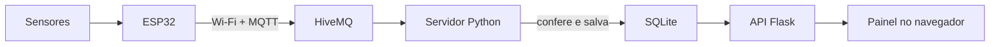

# Estação Meteorológica com ESP32

Protótipo de baixo custo que mede o ambiente com um ESP32, envia as medidas pela
internet e mostra tudo em um painel web com cards, gráficos e mapa.



## O que a estação mede

| Sensor | Mede | Pino do ESP32 |
|---|---|---|
| DHT22 | Temperatura (°C) e umidade (%) | GPIO 14 |
| BMP280 | Pressão atmosférica (hPa) | SDA 21, SCL 22 (I2C) |
| MQ-135 | Qualidade do ar (valor de 0 a 4095, não é ppm) | GPIO 34 (analógico) |
| Sensor de luz digital | Claro ou Escuro | GPIO 35 |

A estação fica em um ponto fixo: latitude `-23.564978600650882`, longitude
`-46.65086234823989`. A posição foi informada pelo grupo, não vem de GPS.

## Duas versões do código

| Pasta | Para que serve |
|---|---|
| `prototipo/` | Versão simplificada: um arquivo para a placa e um para o servidor. É a mais fácil de estudar e apresentar. |
| raiz do projeto | Versão completa: código separado em módulos, display OLED, testes automáticos e mais checagens. |

As duas usam o mesmo tópico MQTT e a mesma mensagem JSON, então a placa com
qualquer um dos firmwares conversa com qualquer um dos servidores. Rode **um
servidor por vez**, porque os dois usam a porta 5000.

## Como rodar o protótipo

**1. Computador** (Python 3.9 ou mais novo):

```powershell
cd prototipo
python -m pip install -r requirements.txt
python servidor.py
```

Abra `http://localhost:5000`.

**2. Placa** (já com MicroPython e `umqtt.simple`): coloque o nome e a senha do
seu Wi-Fi no início de `prototipo/esp32/main.py` e envie os dois arquivos:

```powershell
cd prototipo\esp32
python -m mpremote connect COM3 fs cp boot.py :boot.py + fs cp main.py :main.py + reset
```

Troque `COM3` pela porta da sua placa. Depois disso, basta ligar a placa em
qualquer fonte USB: ela inicia sozinha e envia uma leitura a cada 5 segundos.

## Como rodar a versão completa

```powershell
python -m pip install -r requirements.txt
python app.py                                  # servidor + painel
python -m unittest discover -s tests -v        # 15 testes automáticos
```

Na placa, envie `esp32/boot.py`, `esp32/main.py` e `esp32/ssd1306.py`.

## O painel

- **Cards:** o último valor de cada sensor e o horário da leitura.
- **Gráficos:** as últimas 40 leituras, atualizadas a cada 5 segundos.
- **Mapa:** mostra a estação. Clique em qualquer lugar para ver o vetor
  (leste, norte) e a distância em metros até ela.

## Documentação

- [`docs/GUIA_DO_TIME.md`](docs/GUIA_DO_TIME.md): explicação do código, arquivo
  por arquivo, e dos problemas mais comuns. Também está em `docs/Guia do Time.docx`.
- [`docs/fundamentacao.md`](docs/fundamentacao.md): base teórica resumida.
- `docs/3.2 Objetivo Geral.docx`: seção 3.2 do trabalho escrito.

## Cuidados

- Nunca ligue 5 V direto em um pino do ESP32 ou no BMP280.
- Não publique a senha do Wi-Fi em repositórios públicos.
- O broker HiveMQ é público: qualquer pessoa pode publicar no tópico. O servidor
  descarta mensagens fora do formato, mas isso não é autenticação.
