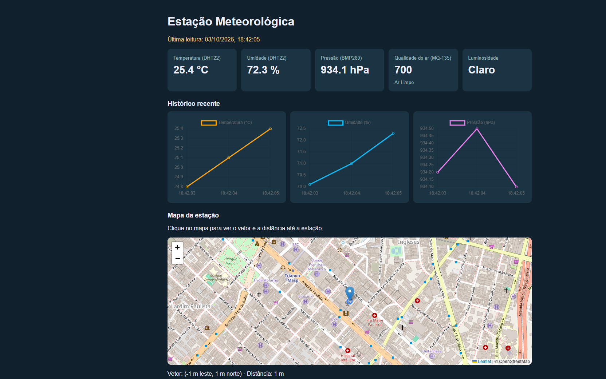

# Guia do Time: entendendo o código da estação

Este guia explica, em linguagem simples, como o código da estação funciona.
A ideia é que qualquer pessoa do grupo consiga abrir um arquivo, entender o que
ele faz e fazer uma alteração sem medo de quebrar o resto.

O foco é a pasta `prototipo/`, a versão simplificada. No final há um resumo da
versão completa e de como as duas se relacionam.

## 1. O caminho de uma medida

Toda medida percorre o mesmo caminho, da placa até a tela:

1. O **ESP32** lê os sensores.
2. Ele monta uma mensagem em **JSON** e a envia pelo **Wi-Fi** usando o
   protocolo **MQTT**.
3. A mensagem chega ao **HiveMQ**, um servidor público que funciona como uma
   "central de recados".
4. O **servidor Python**, no computador, está inscrito no mesmo assunto
   (tópico) e recebe a mensagem.
5. O servidor **confere** se os valores fazem sentido. Se fizerem, **salva** no
   banco **SQLite** com a data e a hora.
6. O **painel** no navegador pergunta ao servidor, a cada 5 segundos, qual é a
   última leitura, e atualiza cards, gráficos e mapa.

A placa e o servidor nunca conversam diretamente: os dois só conhecem o HiveMQ.
Por isso a placa não precisa saber o IP do computador.

## 2. Palavras que aparecem no código

| Termo | Significado no projeto |
|---|---|
| MicroPython | Versão do Python que roda dentro do ESP32. |
| GPIO | Pino da placa onde um sensor é ligado. |
| I2C | Ligação de dois fios (SDA e SCL) usada pelo BMP280. Vários sensores podem dividir os mesmos fios, cada um com seu endereço. |
| ADC | Conversor que transforma uma tensão em número. No ESP32 vai de 0 a 4095. |
| MQTT | Protocolo leve de mensagens: alguém **publica** em um tópico e quem está **inscrito** recebe. |
| Broker | O servidor que distribui as mensagens MQTT. Usamos `broker.hivemq.com`, porta `1883`. |
| Tópico | O "endereço" da mensagem: `universidade/sensores/estacao`. |
| JSON | Formato de texto para dados, como `{"dht22_temp": 25.2}`. |
| SQLite | Banco de dados que fica em um único arquivo (`estacao.db`). |
| Flask | Biblioteca Python que cria o site e a API. |
| API | Endereços que devolvem dados em JSON, como `/api/dados`. |
| Polling | O painel pergunta de tempos em tempos se há dado novo. |

## 3. Organização das pastas

```text
estacao/
├── prototipo/                 VERSÃO SIMPLIFICADA
│   ├── esp32/
│   │   ├── boot.py            roda ao ligar a placa
│   │   └── main.py            lê os sensores e envia por MQTT
│   ├── templates/
│   │   └── painel.html        o painel (cards, gráficos, mapa)
│   ├── servidor.py            recebe, confere, salva e serve o painel
│   └── requirements.txt       bibliotecas do servidor
│
├── esp32/                     firmware da versão completa
├── app.py, mqtt_service.py,   servidor da versão completa,
│   validation.py, database.py,  separado em módulos
│   geo.py
├── templates/index.html       painel da versão completa
├── tests/test_backend.py      testes automáticos
└── docs/                      documentação
```

## 4. A mensagem enviada pela placa

A cada 5 segundos o ESP32 envia exatamente estes seis campos:

```json
{
  "dht22_temp": 25.2,
  "dht22_umi": 77.8,
  "pressao_hpa": 934.41,
  "mq135_valor": 639,
  "mq135_status": "Ar Limpo",
  "luminosidade_estado": "Claro"
}
```

| Campo | Sensor | Unidade | Observação |
|---|---|---|---|
| `dht22_temp` | DHT22 | °C | |
| `dht22_umi` | DHT22 | % | Umidade relativa |
| `pressao_hpa` | BMP280 | hPa | Em São Paulo fica perto de 930 hPa por causa da altitude |
| `mq135_valor` | MQ-135 | 0 a 4095 | Número relativo, não é ppm |
| `mq135_status` | MQ-135 | texto | Calculado pela placa a partir do valor |
| `luminosidade_estado` | sensor de luz | texto | `Claro` ou `Escuro` |

A data e a hora **não** vêm da placa. O servidor anota o horário (em UTC) no
momento em que salva. Assim o histórico fica certo mesmo que o relógio do ESP32
não esteja ajustado.

Se algum campo mudar de nome, é preciso mudar em três lugares: na placa
(`main.py`), no servidor (`CAMPOS` em `servidor.py`) e no painel (`painel.html`).

## 5. A placa: `prototipo/esp32/`

### 5.1 `boot.py`

O MicroPython executa automaticamente `boot.py` e, logo depois, `main.py`
sempre que a placa recebe energia ou é reiniciada. É isso que permite ligar a
estação em qualquer carregador USB sem computador.

O `boot.py` só desliga mensagens internas do sistema e imprime um aviso. Ele
não pode ter um laço infinito, senão o `main.py` nunca começa.

### 5.2 `main.py`, parte por parte

**Configuração.** No topo ficam as informações que mudam de uma instalação para
outra: nome e senha do Wi-Fi, endereço do broker e tópico. `CLIENTE_ID` é um
nome único para a placa no broker, gerado a partir do número de série do chip.
`LUZ_INVERTIDA` existe porque alguns módulos de luz mandam `1` no escuro e
outros no claro.

**Sensores.** Cada sensor vira uma variável:

- `dht22`: o DHT22 no GPIO 14.
- `mq135`: a entrada analógica no GPIO 34. `ATTN_11DB` permite ler tensões até
  cerca de 3,3 V.
- `luz`: entrada digital no GPIO 35. Ela só pode ser `0` ou `1`.
- `i2c`: os fios SDA (GPIO 21) e SCL (GPIO 22) por onde o BMP280 conversa.

**`iniciar_bmp280()`.** O BMP280 pode estar no endereço `0x76` ou `0x77`,
dependendo do módulo. A função testa os dois e confirma o modelo pelo código de
identificação do chip (`0x58`). Depois liga o sensor em modo contínuo e lê os
12 números de calibração que vêm gravados de fábrica em cada peça. Esses números
são necessários para converter a leitura bruta em hPa. Se não achar o sensor,
devolve `None`.

**`ler_pressao()`.** Lê os valores brutos de pressão e temperatura e aplica a
fórmula fornecida pelo fabricante (Bosch). Não é preciso decorar a conta: ela
é sempre a mesma para qualquer BMP280. A temperatura interna do BMP280 só é
usada para corrigir a pressão; a temperatura mostrada no painel vem do DHT22.

**`status_do_ar()`.** Traduz o número do MQ-135 em texto:

| Valor | Status |
|---|---|
| menor que 1200 | Ar Limpo |
| de 1200 a 2499 | Ar Moderado |
| 2500 ou mais | Ar Poluido |

Esses limites são uma referência do projeto, não uma norma. O sensor não está
calibrado para medir gases específicos.

**`conectar()`.** Liga o Wi-Fi, espera até 20 segundos pela conexão e depois
conecta ao broker MQTT. Se algo falhar, devolve `None`, e o programa tenta de
novo no próximo ciclo.

**O laço principal (`while True`).** Repete para sempre, a cada 5 segundos:

1. Se o BMP280 ainda não foi encontrado, tenta de novo. Isso resolve um fio
   que estava solto na hora em que a placa ligou.
2. Lê temperatura, umidade e pressão. Se algum sensor falhar, pula esse ciclo
   em vez de enviar um valor errado.
3. Lê o MQ-135 e o sensor de luz.
4. Monta o JSON e mostra no terminal serial.
5. Se estiver sem conexão, tenta reconectar. Depois publica a mensagem.

Exemplo do que aparece no terminal da placa:

```text
Placa ligada. Iniciando a estacao...
BMP280: 0x76
Conectando ao Wi-Fi...
MQTT conectado
{"dht22_temp": 25.2, "dht22_umi": 77.8, "pressao_hpa": 934.41, ...}
```

## 6. O servidor: `prototipo/servidor.py`

Um único arquivo faz quatro tarefas: recebe por MQTT, confere, salva e entrega
o painel.

**Constantes.** `BROKER` e `TOPICO` precisam ser iguais aos da placa. `BANCO` é
o arquivo `estacao.db`, criado ao lado do `servidor.py`. `ESTACAO` guarda a
coordenada fixa usada no mapa. `CAMPOS` lista os seis campos esperados e
`LIMITES` diz a faixa aceita para cada número.

**`executar()` e `criar_banco()`.** `executar()` abre o banco, roda um comando
SQL, devolve as linhas como dicionários e fecha o arquivo. `criar_banco()` cria
a tabela `leituras` se ela ainda não existir:

| Coluna | Tipo | Conteúdo |
|---|---|---|
| `id` | inteiro | Número sequencial da leitura |
| `timestamp` | texto | Data e hora UTC, ex.: `2026-10-03T02:44:02Z` |
| `dht22_temp` | real | Temperatura |
| `dht22_umi` | real | Umidade |
| `pressao_hpa` | real | Pressão |
| `mq135_valor` | inteiro | Valor do MQ-135 |
| `mq135_status` | texto | Status do ar |
| `luminosidade_estado` | texto | Claro ou Escuro |

**`validar()`.** É a "lógica matemática" do trabalho: cada regra é uma condição
verdadeira ou falsa, e a leitura só é salva se **todas** forem verdadeiras.

| Regra | Por que existe |
|---|---|
| Ter exatamente os seis campos | Evita mensagens de outros projetos no mesmo tópico |
| Números serem números | Rejeita textos como `"25"` |
| Temperatura entre -40 e 80 °C | Faixa do DHT22 |
| Umidade entre 0 e 100 % | Não existe umidade fora disso |
| Pressão entre 300 e 1100 hPa | Faixa do BMP280 |
| MQ-135 inteiro entre 0 e 4095 | Faixa do ADC do ESP32 |
| Status do ar combinar com o valor | A placa e o servidor usam os mesmos limites |
| Luz ser `Claro` ou `Escuro` | Únicos estados do sensor |

A função devolve `None` quando está tudo certo, ou um texto explicando o
primeiro problema encontrado. Esse texto aparece no terminal como
`Rejeitado: ...`.

**`ao_conectar()` e `ao_receber()`.** São funções chamadas pela biblioteca
Paho MQTT. A primeira se inscreve no tópico assim que a conexão abre. A
segunda roda a cada mensagem: transforma o texto em dicionário, chama
`validar()` e, se estiver tudo certo, grava no banco com o horário atual.

**Rotas do site.**

| Endereço | O que devolve |
|---|---|
| `/` | O painel (`templates/painel.html`) |
| `/api/dados` | A última leitura. Se o banco estiver vazio, devolve erro 404 com a mensagem "Nenhuma leitura recebida ainda" |
| `/api/historico` | As últimas 40 leituras, da mais antiga para a mais nova |

**Inicialização.** No final do arquivo o cliente MQTT é criado, conectado e
colocado para rodar em segundo plano (`loop_start`). A própria biblioteca
reconecta sozinha se a internet cair. Em seguida o Flask sobe na porta 5000.

## 7. O painel: `prototipo/templates/painel.html`

O painel é uma página HTML com um pouco de CSS e JavaScript. Ele usa duas
bibliotecas carregadas da internet: **Chart.js** para os gráficos e
**Leaflet** com mapas do **OpenStreetMap**. Por isso o computador que abre o
painel precisa de internet.



**Cards.** Cada card tem um `id` (`temp`, `umi`, `pressao`, `ar`, `luz`). A
função `atualizar()` busca `/api/dados` e escreve o valor em cada um. Se a API
responder com erro, o aviso no topo mostra "Sem dados".

**Gráficos.** `novoGrafico()` cria um gráfico de linha. Há três: temperatura,
umidade e pressão. A cada atualização, `atualizar()` busca `/api/historico`,
troca os pontos e redesenha.

**Atualização automática.** `setInterval(atualizar, 5000)` chama a função a
cada 5 segundos, o mesmo ritmo da placa. A página nunca precisa ser recarregada.

**Mapa e geometria analítica.** A coordenada da estação vem do servidor
(`ESTACAO`). Ao clicar no mapa, o código calcula o vetor entre a estação e o
ponto clicado:

- **norte** = diferença de latitude × 111.320 m
- **leste** = diferença de longitude × 111.320 m × cos(latitude da estação)
- **distância** = √(leste² + norte²)

Um grau de latitude vale cerca de 111,32 km. Já um grau de longitude encolhe
conforme nos afastamos do Equador, por isso a multiplicação pelo cosseno. A
distância é o módulo do vetor, pelo teorema de Pitágoras. A conta é uma
aproximação, boa para distâncias de alguns quilômetros.

## 8. Como rodar e testar

### 8.1 Servidor e painel

```powershell
cd prototipo
python -m pip install -r requirements.txt
python servidor.py
```

O terminal deve mostrar `MQTT: Success - ouvindo universidade/sensores/estacao`.
Abra `http://localhost:5000`. Enquanto nenhuma leitura chegar, o painel mostra
"Sem dados: Nenhuma leitura recebida ainda".

### 8.2 Placa

1. A placa precisa ter MicroPython gravado e a biblioteca `umqtt.simple`.
   Para instalar a biblioteca pelo computador (precisa de internet no PC):
   `python -m mpremote connect COM3 mip install umqtt.simple`.
2. Coloque o nome e a senha do Wi-Fi em `WIFI_NOME` e `WIFI_SENHA`. O ESP32 só
   funciona em redes de 2,4 GHz.
3. Feche qualquer programa que esteja usando a porta (monitor serial, outro
   terminal com `mpremote`). Depois envie os arquivos:

```powershell
cd prototipo\esp32
python -m mpremote connect COM3 fs cp boot.py :boot.py + fs cp main.py :main.py + reset
```

4. Para acompanhar o que a placa está fazendo: `python -m mpremote connect COM3`.
   Para sair, use `Ctrl + ]`.

### 8.3 Testar o painel sem a placa

Com o servidor rodando, este comando envia uma leitura falsa ao tópico. Use
somente quando a placa real não estiver ligada, para não misturar dados.

```powershell
python -c "import json, paho.mqtt.publish as p; p.single('universidade/sensores/estacao', json.dumps({'dht22_temp': 24.5, 'dht22_umi': 60.0, 'pressao_hpa': 930.0, 'mq135_valor': 500, 'mq135_status': 'Ar Limpo', 'luminosidade_estado': 'Claro'}), hostname='broker.hivemq.com')"
```

O terminal do servidor deve mostrar `Salvo: ...` e o painel deve atualizar em
até 5 segundos. Troque um valor por algo impossível (por exemplo, umidade 150)
e veja o servidor responder `Rejeitado: dht22_umi fora da faixa 0 a 100`.

### 8.4 Ver o banco de dados

Dentro da pasta `prototipo/`:

```powershell
python -c "import sqlite3; [print(l) for l in sqlite3.connect('estacao.db').execute('SELECT * FROM leituras ORDER BY id DESC LIMIT 5')]"
```

Para começar do zero, pare o servidor e apague o arquivo `estacao.db`.

## 9. Problemas comuns

| Sintoma | Causa provável | O que fazer |
|---|---|---|
| `BMP280 nao encontrado` | Fio SDA/SCL solto ou invertido | Confira SDA no GPIO 21 e SCL no GPIO 22, com VCC em 3V3 |
| `Sem Wi-Fi` | Senha errada ou rede de 5 GHz | Use uma rede 2,4 GHz e confira a senha |
| `Falha ao ler sensor` | DHT22 mal encaixado | Confira o fio de dados no GPIO 14 |
| `could not enter raw repl` ou porta em uso | Outro programa usando a COM | Feche o monitor serial e tente de novo |
| Painel "Sem dados" | Servidor sem receber nada | Veja se a placa mostra `MQTT conectado` e se o tópico é o mesmo |
| Claro/Escuro trocados | Módulo de luz invertido | Mude `LUZ_INVERTIDA` para `True` |
| Painel diferente do esperado ou erro 404 nas rotas | Outro servidor antigo ainda aberto na porta 5000 (no Windows o segundo sobe sem avisar) | Feche todos os terminais com servidor e rode só um |
| Mapa ou gráficos não aparecem | Computador sem internet | As bibliotecas e o mapa vêm da internet |

## 10. Receitas de alteração

**Mudar o intervalo de envio.** Troque o `time.sleep(5)` no laço da placa e o
`5000` do `setInterval` no painel (em milissegundos).

**Mudar a posição da estação.** Troque `ESTACAO` em `servidor.py`.

**Adicionar um sensor novo.**

1. Em `main.py`, leia o sensor e acrescente um campo novo no JSON.
2. Em `servidor.py`, acrescente o nome em `CAMPOS`, a faixa em `LIMITES` (se for
   número), a coluna em `criar_banco()` e mais um `?` no `INSERT`.
3. Apague o `estacao.db` antigo, porque a tabela mudou.
4. Em `painel.html`, crie um card com um `id` novo e preencha em `atualizar()`.

## 11. A versão completa

A versão completa, na raiz do projeto, faz o mesmo trabalho com mais
acabamento. Os campos, o tópico e as regras de conferência são os mesmos.

| Tarefa | Protótipo | Versão completa |
|---|---|---|
| Firmware | `prototipo/esp32/main.py` | `esp32/main.py` com display OLED (`ssd1306.py`) mostrando as leituras |
| Receber MQTT | `servidor.py` | `mqtt_service.py` |
| Conferir dados | `validar()` | `validation.py` (mesmas regras, com mensagens de erro mais detalhadas) |
| Banco | `executar()` | `database.py` (histórico de até 500 leituras, índice por data) |
| Site e API | rotas em `servidor.py` | `app.py` com `/api/historico?limite=`, `/api/estacao` e `/api/distancia` |
| Distância no mapa | calculada no navegador | calculada no servidor (`geo.py`), com a distância vetorial e a geográfica (haversine) |
| Painel | `painel.html` | `templates/index.html`, com visual mais elaborado |
| Testes | verificação manual | 15 testes automáticos em `tests/` |

Os arquivos `esp32/diagram.json` e `esp32/wokwi.toml` são da fase de simulação
no Wokwi, quando o circuito ainda usava BMP180, LDR analógico e pluviômetro.
Eles não representam a montagem física atual.

## 12. Limitações conhecidas

- O HiveMQ público não exige senha: qualquer pessoa pode publicar no tópico. A
  conferência descarta mensagens fora do formato, mas não é uma proteção real.
- Se a internet cair, as leituras desse período não ficam guardadas na placa.
- O MQ-135 e o sensor de luz dão valores indicativos, sem calibração.
- A pressão não é convertida para o nível do mar, por isso fica abaixo de
  1013 hPa em São Paulo.
- O painel roda no computador do grupo. Para acesso público, o servidor
  precisaria ser hospedado na internet.

## 13. Cuidados elétricos

- Monte e altere fios com a placa desligada do USB.
- Alimente o BMP280 e o DHT22 pelo pino 3V3. Nunca ligue 5 V em um GPIO.
- Muitos módulos MQ-135 são alimentados com 5 V e podem enviar até 5 V no
  pino AO. Meça com multímetro antes de ligar no GPIO 34. Se passar de 3,3 V,
  use um divisor de tensão.
- Os GPIO 34 e 35 só funcionam como entrada.
